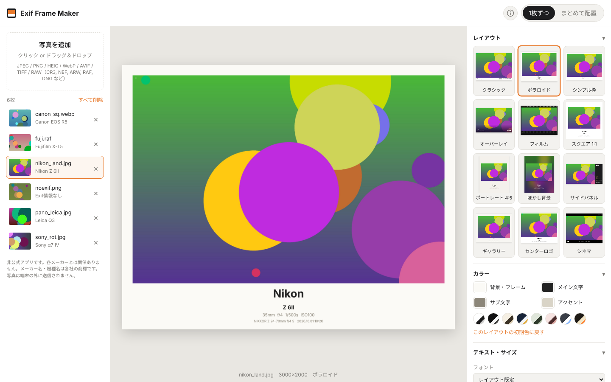

# Exif Frame Maker

写真の Exif 情報（メーカー・機種・レンズ・焦点距離・F値・シャッター速度・ISO・撮影日時）を読み取り、撮影データ入りのフレームを付けて書き出すブラウザアプリです。
画像はすべてブラウザ内で処理され、サーバーへアップロードされません。



## 主な機能

- **複数枚の読み込み・書き出し**：ドラッグ＆ドロップでまとめて追加。ZIP で一括保存、または個別に連続保存。
- **さまざまな形式に対応**
  - JPEG / PNG / WebP / AVIF / GIF / BMP
  - HEIC / HEIF（iPhone）… 端末・ブラウザ標準の機能で読み込み（iPhone/MacのSafari、Androidアプリ版）。アプリ内にHEVCデコーダーは同梱していません
  - TIFF … `utif` でデコード
  - RAW（CR2 / CR3 / NEF / ARW / RAF / ORF / RW2 / DNG / PEF など）… ファイル内蔵の最大JPEGプレビューを使用
  - 出力は JPEG / PNG / WebP（画質・長辺サイズを指定可）
- **14種類のレイアウトプリセット**
  クラシック / ポラロイド / シンプル枠 / オーバーレイ / フィルム / スクエア 1:1 / ポートレート 4:5 / ぼかし背景 / サイドパネル / ギャラリー / センターロゴ / シネマ / 四隅 / 四隅フチ
  - 「四隅」「四隅フチ」は、左上・右上・左下・右下それぞれに表示する項目（メーカー名・機種・レンズ・撮影設定・日時・クレジット）を選べます
- **比率の違う写真も自動レイアウト**
  - 文字サイズやフチは写真の大きさ・比率から自動計算（縦位置・横位置・パノラマでもバランスを維持）
  - EXIF の回転情報（Orientation）を自動反映
  - 出力比率（1:1・4:5・9:16・16:9 など）を指定すると、どの写真も同じ比率のキャンバスに自動で収める
- **カラー・文字のカスタマイズ**：プリセットを選んだ後、背景／メイン文字／サブ文字／アクセントの4色を変更。8種類のカラーパレット、フォント選択、文字サイズ・フチの太さ、表示する項目の切り替え、撮影者名（クレジット）の追加・文字サイズ変更・四隅への配置。
- **フォントの読み込み**：手持ちのフォント（TTF / OTF / WOFF / WOFF2）を読み込んで使えます（端末内にだけ保存）。詳細オプションでメーカー名・機種・レンズ・撮影設定・撮影日時・クレジットごとにフォントを変更可能。
- **マイプリセット**：レイアウト・色・フォント・文字サイズ・表示項目・クレジット・四隅の配置をまとめて名前付きで保存し、ワンタップで呼び出し。名前変更・上書き・削除、JSONファイルへの書き出し（保存タブ）／読み込みに対応。レイアウト一覧の最後の「＋」で今の設定を保存、その下の「読込」でファイルから読み込み。
- **Exif の手動編集**：写真ごとに表示内容を書き換え可能（Exif が無い画像でも使えます）。
- **メーカー名・ロゴ**：標準ではメーカー名をレイアウト共通の書体で普通の文字として表示（各社ロゴには似せていません）。利用者が自分で用意したロゴ画像を登録することもできます（端末内に保存・改変せず表示）。

## 権利・ライセンスについて

- **非公式アプリです。** 各カメラメーカー・スマートフォンメーカーとは関係がなく、承認・提携を受けたものではありません。表示されるメーカー名・機種名は、Exifに記録された撮影機材を示すためのもので、各社の商標または登録商標です。
- **ロゴは同梱していません。** メーカー名は各社ロゴに似せない共通の書体で表示します。ロゴ画像を登録する機能は、利用者が自分で利用条件を確認して使うためのものです。多くのメーカーはロゴの改変・商用利用を認めていないため、ロゴ入り画像は個人的な利用にとどめてください。
- **HEIC（HEVC）**：特許のある動画方式を使うため、アプリ内にデコーダーを同梱せず、OS・ブラウザに標準搭載された機能だけで読み込みます。
- **プライバシー**：写真は端末内だけで処理され、外部に送信されません。書き出した画像に位置情報などのExifは残りません。解析ツールや広告は使用していません。
- **オープンソースライセンス**：使用しているライブラリ（MIT / ISC / 0BSD / Zlib / Apache-2.0）とフォント（SIL Open Font License 1.1）のライセンス文は [`public/THIRD_PARTY_LICENSES.txt`](public/THIRD_PARTY_LICENSES.txt) にまとめ、Webサイト・APKの両方に同梱しています（アプリ内の ⓘ → ライセンス から表示）。依存関係を変えたら `npm run licenses` で再生成されます（`npm run build` でも自動実行）。

> 法律の専門家による確認を経たものではありません。有料化・商用利用を行う場合は専門家にご相談ください。

## 使い方（ローカル）

```bash
npm install
npm run dev      # 開発サーバー http://localhost:5173
npm run build    # dist/ に本番ビルド
npm run preview  # ビルド結果の確認
```

## GitHub Pages で公開

`.github/workflows/deploy.yml` が `main` への push で自動ビルド・デプロイします。
初回のみリポジトリの **Settings → Pages → Build and deployment → Source** を **GitHub Actions** に設定してください。

## 構成

| ファイル | 内容 |
| --- | --- |
| `src/decode.ts` | 各形式のデコード、Exif 解析、RAW 内蔵プレビュー抽出 |
| `src/layouts.ts` | 12種類のレイアウトプリセット |
| `src/draw.ts` | テキスト・ロゴ描画などの共通処理 |
| `src/render.ts` | プレビュー／書き出しの描画 |
| `src/makers.ts` | メーカー判定、ワードマーク、機種名の整形 |
| `src/logos.ts` | ロゴ画像の登録・保存（IndexedDB） |
| `src/main.ts` | UI |

## ライセンス

MIT
